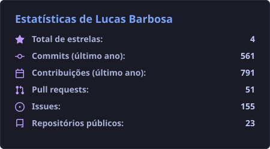
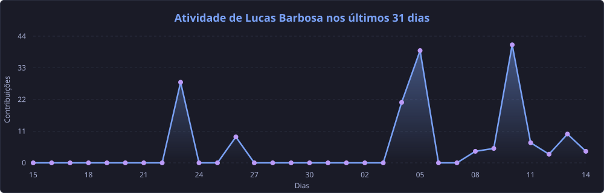

 

---

## 🔥 Sobre Mim

**Desenvolvedor Full Stack apaixonado por criar soluções inovadoras e elegantes!**

- 💻 Sempre aprendendo novas tecnologias
- 🚀 Focado em entregar código limpo e performático
- 🤝 Aberto a colaborações e novos desafios

---

## 🛠️ Tech Stack

&nbsp;
&nbsp;
&nbsp;
&nbsp;
&nbsp;

---

## 📊 GitHub Stats

  

  

<picture>
  <source media="(prefers-color-scheme: dark)" srcset="https://raw.githubusercontent.com/devlucas-tec/devlucas-tec/output/pacman-contribution-graph-dark.svg">
  <source media="(prefers-color-scheme: light)" srcset="https://raw.githubusercontent.com/devlucas-tec/devlucas-tec/output/pacman-contribution-graph.svg">
  
</picture>

---

## 📫 Entre em Contato

  

